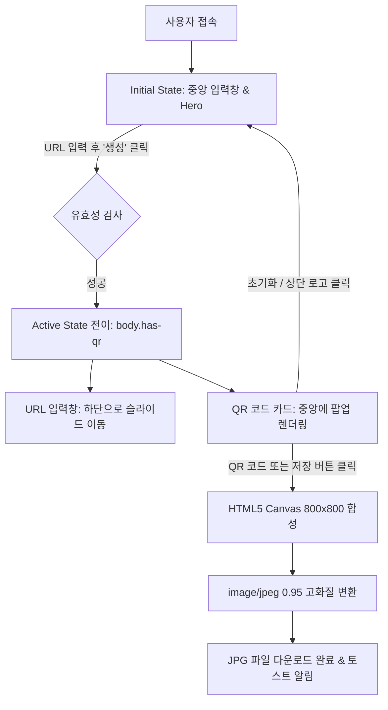

# QR Studio - 구현 계획, 워크스루 및 작업 목록

QR 코드 생성 및 고화질 JPG 다운로드 웹 애플리케이션에 대한 **구현 계획(Implementation Plan)**, **사용자 여정 및 워크스루(Walkthrough)**, 그리고 **세부 작업 목록(Task List)** 문서입니다.

---

## 1. 📋 구현 계획 (Implementation Plan)

### 1.1 프로젝트 개요 및 핵심 요구사항
- **목표**: 사용자가 입력한 웹 링크(URL)를 세련된 QR 코드로 실시간 변환하고, 화면 중앙에서 직관적으로 확인 후 원클릭으로 고화질 JPG 파일로 다운로드할 수 있는 웹 서비스 구축.
- **핵심 요구사항 매핑**:
  1. **상단 좌측 로고**: `img/logo.png` 이미지를 좌측 상단 헤더에 배치 및 클릭 시 홈 리셋 기능 제공.
  2. **중앙 심플 URL 입력**: 초기 화면 중앙에 배치된 직관적이고 세련된 URL 입력 인터페이스.
  3. **부드러운 하단 이동 & QR 중앙 노출**: URL 확인 시 입력창이 화면 하단으로 부드럽게 슬라이드되고, 화면 중앙에 QR 카드 팝업.
  4. **원클릭 JPG 다운로드**: QR 코드 이미지(또는 카드) 클릭 시 Canvas 기반 800x800 고해상도 JPG 파일 자동 생성 및 다운로드.

---

### 1.2 시스템 아키텍처 & 상태 설계



---

### 1.3 기술 스택 및 라이브러리 구성

| 구분 | 기술 / 라이브러리 | 적용 목적 및 특징 |
| :--- | :--- | :--- |
| **Markup** | HTML5 Semantic Web | 접근성 표준, 메타 태그, 구조적 래퍼 |
| **Styling** | Vanilla Modern CSS3 | 글래스모피즘 (`backdrop-filter`), 네온 글로우 오로라, 유려한 CSS 트랜지션 |
| **Logic** | Vanilla ES6+ JavaScript | UI 상태 전이, URL 포맷팅, 이벤트 위임, 토스트 알림 |
| **QR Engine** | `qrcode.js` (with Fallback) | 클라이언트 사이드 고속 2D 매트릭스 렌더링 (Error Correction Level: H) |
| **Export** | HTML5 Canvas API | 무손실 화이트 배경 + 여백 + URL 라벨이 합성된 초고화질 `.jpg` 변환 |
| **Typography** | Google Fonts (Outfit / Plus Jakarta Sans) | 모던하고 가독성 높은 프리미엄 산세리프 폰트 |
| **Icons** | Font Awesome 6 | 일관된 모던 벡터 아이콘 셋 |

---

## 2. 🚶‍♂️ 워크스루 (Walkthrough)

### 2.1 화면 구성 및 상태 전환

```
[ 초기 화면 (Initial State) ]
┌──────────────────────────────────────────────────┐
│ [Logo] QR Studio PRO                             │
│                                                  │
│               웹 링크를 세련된 QR 코드로             │
│            URL을 입력하면 즉시 생성됩니다.             │
│                                                  │
│   ┌────────────────────────────────────────┐     │
│   │ 🌐 https://naver.com            [QR 생성] │     │
│   └────────────────────────────────────────┘     │
│        [Google]  [Naver]  [YouTube]  [GitHub]    │
└──────────────────────────────────────────────────┘

                       ▼ (QR 생성 클릭 시 트랜지션)

[ QR 활성화 화면 (Active State: has-qr) ]
┌──────────────────────────────────────────────────┐
│ [Logo] QR Studio PRO                             │
│                                                  │
│              ┌───────────────────────┐           │
│              │   ✨ JPG 다운로드      │           │
│              │   ┌───────────────┐   │           │
│              │   │   QR CODE     │   │ (중앙 팝업) │
│              │   └───────────────┘   │           │
│              │   🔗 https://naver.com│           │
│              │   [복사] [JPG저장] [리셋]│           │
│              └───────────────────────┘           │
│                                                  │
│   ┌────────────────────────────────────────┐     │ (하단 고정)
│   │ 🌐 https://naver.com            [QR 생성] │     │
│   └────────────────────────────────────────┘     │
└──────────────────────────────────────────────────┘
```

---

### 2.2 사용자 시나리오 단계별 흐름

1. **서비스 진입 & 브랜드 확인**:
   - 좌측 상단 [img/logo.png](file:///d:/Webwork/Vibecoding/프로젝트04/img/logo.png) 로고와 모던한 배경 오로라 이펙트가 사용자에게 신뢰감 있는 첫인상을 제공합니다.
2. **URL 입력**:
   - 중앙 입력창에 직접 링크를 입력하거나, 하단의 `Google`, `Naver`, `YouTube` 등 빠른 테스트 칩을 클릭합니다.
   - `http://` 나 `https://` 가 생략되어도 자동 보정 처리됩니다.
3. **생성 및 화면 인터랙션**:
   - `Enter` 키 또는 `[QR 생성]` 버튼을 클릭하면 `body.classList.add('has-qr')`가 적용됩니다.
   - Hero 영역이 자연스럽게 축소되고, **입력창이 부드러운 곡선 애니메이션으로 하단으로 이동**합니다.
   - **화면 정중앙에 화이트 QR 코드 카드가 입체감 있게 팝업**됩니다.
4. **원클릭 JPG 다운로드**:
   - 생성된 QR 코드를 마우스로 가리키면(Hover) 다운로드 오버레이 안내가 나타납니다.
   - **QR 코드 영역을 클릭**하면 800x800 고화질 캔버스가 백그라운드에서 생성되어 깨끗한 흰색 배경과 함께 `qrcode_[도메인].jpg` 형식으로 즉시 다운로드됩니다.
5. **부가 액션 및 리셋**:
   - `[링크 복사]`: 생성된 URL을 클립보드로 복사.
   - `[초기화]` 또는 `[상단 로고 클릭]`: 언제든 초기 화면으로 복귀하여 새로운 링크를 작업할 수 있습니다.

---

## 3. ✅ 작업 목록 (Task List)

- [x] **1. 프로젝트 환경 분석 및 자산 확인**
  - [x] 워크스페이스 내 [img/logo.png](file:///d:/Webwork/Vibecoding/프로젝트04/img/logo.png) 파일 유무 및 규격 확인
  - [x] 단일 디렉토리 순수 웹 구조 설계
- [x] **2. 구조 마크업 ([index.html](file:///d:/Webwork/Vibecoding/프로젝트04/index.html))**
  - [x] 상단 좌측 로고 컨테이너 및 이미지 에러 Fallback 마크업
  - [x] Hero 타이틀 섹션 및 중앙 입력 폼 구성
  - [x] 중앙 팝업 QR 코드 디스플레이 카드 및 오버레이 컴포넌트
  - [x] 퀵 샘플 칩 및 토스트 알림 컨테이너
  - [x] `qrcode.js` 라이브러리 CDN 및 장애 대비 보조 CDN Fallback 적용
- [x] **3. 모던 디자인 시스템 & 애니메이션 ([style.css](file:///d:/Webwork/Vibecoding/프로젝트04/style.css))**
  - [x] 다크 테마 색상 팔레트 및 오로라/네온 글로우 애니메이션 (`@keyframes floatOrb`)
  - [x] 글래스모피즘 카드 및 고광택 테두리 효과
  - [x] 상태 전환 트랜지션 (중앙 $\rightarrow$ 하단 슬라이드: `.has-qr .input-section`)
  - [x] QR 카드 팝업 바운스 애니메이션 (`@keyframes qrCardEntrance`)
  - [x] 모바일 및 태블릿 완벽 대응 반응형 미디어 쿼리
- [x] **4. 핵심 기능 구현 ([script.js](file:///d:/Webwork/Vibecoding/프로젝트04/script.js))**
  - [x] 입력 필드 유효성 검사 및 프로토콜 자동 보정
  - [x] `qrcode.js` 고해상도(Level H) QR 코드 생성 로직
  - [x] **HTML5 Canvas 기반 800x800 JPG 내보내기 엔진** (화이트 백그라운드 + 마진 + 라벨 합성)
  - [x] QR 카드 클릭 시 즉시 다운로드 트리거 이벤트 바인딩
  - [x] 클립보드 복사, 폼 초기화, 실시간 토스트 알림 시스템
- [x] **5. 검증 및 최적화**
  - [x] 독립 파일(`file://`) 및 로컬 HTTP 서버(`http://localhost:5500`) 호환성 보장
  - [x] 크로스 브라우징 및 다운로드 파일 포맷/파일명 무결성 확인

---

> [!TIP]
> 언제든지 [index.html](file:///d:/Webwork/Vibecoding/프로젝트04/index.html)을 웹 브라우저로 열거나 로컬 서버([http://localhost:5500](http://localhost:5500))에서 전체 인터랙션을 직접 체험하실 수 있습니다.
